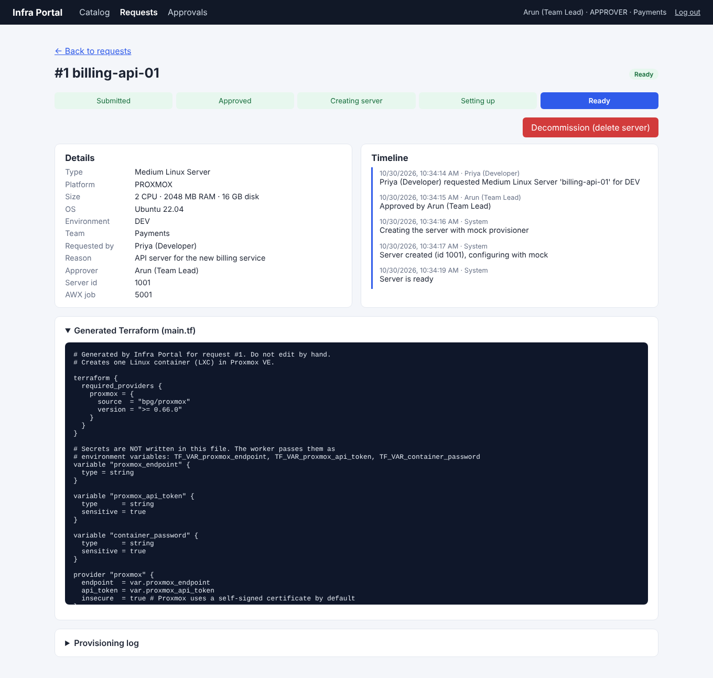

# Infra Portal: self-service infrastructure management

A working prototype of a self-service portal for requesting servers on **Proxmox VE** and **AWS**, similar in idea to VMware vRealize Automation (Aria).

A developer picks a server from a **service catalog** and fills in a short form. Their **team lead approves** it. The backend then **generates Terraform code** and a background **worker** creates the server and configures it, while the UI shows every status change live.



## Features

| Feature | Where |
|---|---|
| Service catalog with request forms | `frontend/src/pages/CatalogPage.tsx` |
| Approval workflow (approve / reject with comment) | `backend/src/routes/requests.routes.ts` |
| RBAC: requester, approver, admin (production needs admin) | `backend/src/middleware/auth.ts`, `requests.routes.ts` |
| Team quotas (CPU / RAM / disk), checked on request and on approval | `backend/src/services/quota.service.ts` |
| Request state machine with full audit trail | `backend/src/services/requestStatus.service.ts` |
| Terraform (HCL) generation from templates (Proxmox LXC, AWS EC2) | `backend/src/terraform/generator.ts`, `backend/terraform-templates/` |
| Background worker with a message queue (Redis + BullMQ) | `backend/src/worker.ts`, `backend/src/queue/queue.ts` |
| Provisioners: mock, **real local Terraform**, GitLab CI pipeline | `backend/src/connectors/` |
| Configurators: mock, AWX job template | `backend/src/connectors/` |
| Retry failed requests, decommission (delete) servers | request detail page |
| Lease / expiry: servers are decommissioned automatically when the lease ends, owners can extend | `backend/src/jobs.ts`, request form and detail page |
| Automated tests (API, workflow, RBAC, quotas, leases) and CI | `backend/tests/`, `.github/workflows/ci.yml` |
| Admin: edit quotas, enable/disable catalog items, audit log | `frontend/src/pages/AdminPage.tsx` |

## Tech stack

- **Frontend:** React 19 + TypeScript + Vite, React Router, plain CSS
- **Backend:** Node.js + Express + TypeScript, Prisma ORM, Zod validation, JWT auth
- **Database:** PostgreSQL 16
- **Queue:** Redis + BullMQ (separate worker process)
- **Infrastructure as code:** Terraform (bpg/proxmox and hashicorp/aws providers)
- **Integrations:** GitLab CI API, AWX API (real code + mock versions)

See [docs/architecture.md](docs/architecture.md) for the architecture diagram and request life cycle.

## Documents

| Document | What it is |
|---|---|
| [SUBMISSION.md](SUBMISSION.md) | One-page index of the deliverables |
| [docs/architecture.md](docs/architecture.md) | Architecture, request life cycle, sequence, data model, security rules ([images](docs/diagrams/)) |
| [docs/demo.md](docs/demo.md) | Step-by-step demo with screenshots |
| [docs/Infra-Portal-Presentation.pdf](docs/Infra-Portal-Presentation.pdf) | 11-slide presentation |
| [docs/setup-windows-proxmox.md](docs/setup-windows-proxmox.md) | Windows setup with Proxmox VE in VirtualBox |
| [docs/setup-gitlab.md](docs/setup-gitlab.md) | Provisioning through a GitLab CI pipeline, with a runner on your laptop |

## Repository layout

```
infra-portal/
  backend/                 API + worker (one Node project, two processes)
    prisma/                database schema, migrations, seed data
    src/routes/            REST endpoints
    src/services/          business rules (quota, state machine, audit)
    src/terraform/         HCL generator and Terraform CLI runner
    src/connectors/        provisioners and configurators (mock / real)
    src/worker.ts          background job processor
    terraform-templates/   .tf templates with {{placeholders}}
  frontend/                React app
  gitlab/.gitlab-ci.yml    pipeline for PROVISIONER=gitlab
  gitlab/runner/           GitLab Runner for your own machine (reaches Proxmox on your network)
  ansible/                 sample playbook for the AWX job template
  docs/                    architecture, demo guide, screenshots
  docker-compose.yml       runs everything
```

## Quick start (Docker, everything in mock mode)

Requirements: Docker Desktop.

```bash
git clone https://github.com/Muthujar/infra-portal.git
cd infra-portal
cp backend/.env.example backend/.env       # Windows: copy backend\.env.example backend\.env
docker compose up --build
```

Open **http://localhost:8080** and use one of the demo users (password `Password@123`):

| Email | Role | Can do |
|---|---|---|
| `dev@demo.local` | Requester (team Payments) | request servers, see own requests |
| `lead@demo.local` | Approver (team Payments) | approve DEV/QA requests of the team |
| `admin@demo.local` | Admin (team Platform) | approve PROD, edit quotas, see audit log |

The login page has one-click buttons for each demo user.

## Local development (without Docker for the apps)

Requirements: Node.js 20+, and Docker for Postgres and Redis (or install them locally).

```bash
# 1. Databases
docker compose up -d postgres redis

# 2. Backend (terminal 1)
cd backend
cp .env.example .env
npm install
npx prisma migrate deploy
npm run db:seed
npm run dev                 # API on http://localhost:4000

# 3. Worker (terminal 2)
cd backend
npm run worker

# 4. Frontend (terminal 3)
cd frontend
npm install
npm run dev                 # UI on http://localhost:5173 (calls to /api go to port 4000)
```

## Modes: what is real and what is simulated

Set these in `backend/.env` and restart the API and worker.

| Setting | Values | What happens |
|---|---|---|
| `PROVISIONER` | `mock` (default) | Simulates Terraform with a short delay. A hostname containing `fail` simulates a failure. |
| | `local` | Runs the real `terraform init/apply/destroy` on the worker machine, one folder per request. |
| | `gitlab` | Commits `main.tf` to a GitLab repo, runs a pipeline and copies its Terraform output back. Setup: [docs/setup-gitlab.md](docs/setup-gitlab.md). |
| `CONFIGURATOR` | `mock` (default) | Simulates an AWX job. |
| | `awx` | Launches a real AWX job template and waits for it (see `ansible/configure-server.yml`). |
| `AWS_APPLY_ENABLED` | `false` (default) | AWS requests run `terraform validate` only, so there is no cloud cost. |
| `LEASE_CHECK_INTERVAL_MS` | `60000` (default) | How often the worker looks for servers whose lease has ended. |

## Using real Proxmox (PROVISIONER=local)

Proxmox VE can run inside VirtualBox on a laptop (16 GB+ RAM recommended). For a detailed Windows walkthrough with troubleshooting, see [docs/setup-windows-proxmox.md](docs/setup-windows-proxmox.md).

1. Enable virtualization (Intel VT-x / AMD-V) in the BIOS.
2. Create a VirtualBox VM: 8 GB RAM, 2-4 CPUs, 64 GB disk, network adapter in **Bridged** mode. Install Proxmox VE from the official ISO.
3. Open `https://<proxmox-ip>:8006`, log in as `root`.
4. Download a container template: *local (pve) > CT Templates > Templates > ubuntu-22.04-standard*.
5. Create an API token: *Datacenter > Permissions > API Tokens > Add* (user `root@pam`, uncheck "Privilege Separation" for the prototype). Copy the secret.
6. Install the Terraform CLI on the machine that runs the worker (`terraform -version` must work).
7. In `backend/.env`:
   ```
   PROVISIONER=local
   PROXMOX_ENDPOINT=https://<proxmox-ip>:8006/
   PROXMOX_API_TOKEN=root@pam!portal=<secret>
   PROXMOX_NODE=pve            # the node name shown in the Proxmox tree
   PROXMOX_DATASTORE=local-lvm
   PROXMOX_LXC_TEMPLATE=local:vztmpl/ubuntu-22.04-standard_22.04-1_amd64.tar.zst
   ```
   Check the exact template file name in Proxmox (*local > CT Templates*).
8. Restart the worker, then request a Proxmox server and approve it. The container appears in the Proxmox UI. Decommission it from the portal to delete it.

Terraform files and state are kept in `backend/terraform-runs/request-<id>/`.

Before approving a real request, check the settings against Proxmox (and GitLab, with `PROVISIONER=gitlab`).
It only reads, and prints what to fix:

```bash
docker compose run --rm api npx tsx scripts/check-setup.ts
```

## Tests and CI

The backend tests run the API and the worker's job functions against a real PostgreSQL database (no Redis needed).
They use their own database, `infra_portal_test`, which is emptied and seeded at the start of every run.

```bash
docker compose up -d postgres
docker compose exec postgres createdb -U portal infra_portal_test   # first time only
cd backend
npm test
```

To check a running portal end to end (needs `curl` and `jq`, e.g. Git Bash on Windows):

```bash
scripts/smoke-test.sh http://localhost:8080
```

GitHub Actions (`.github/workflows/ci.yml`) runs on every push and pull request:

| Job | What it checks |
|---|---|
| backend | typecheck, all tests, build |
| frontend | lint, build |
| terraform | the generated Proxmox and AWS files pass `terraform fmt` and `terraform validate` with the real providers |
| docker | `docker compose up --build`, then the smoke test through the web container |

## API overview

All endpoints are under `/api` and need `Authorization: Bearer <token>` except login.

| Method | Path | Who |
|---|---|---|
| POST | `/auth/login` | anyone |
| GET | `/auth/me` | logged in |
| GET | `/catalog` | logged in |
| POST, PATCH | `/catalog`, `/catalog/:id` | admin |
| GET | `/requests` | logged in (filtered by role) |
| GET | `/requests/pending-approvals` | approver, admin |
| GET | `/requests/:id` | owner, team approver, admin |
| POST | `/requests` | logged in |
| POST | `/requests/:id/approve`, `/reject` | approver (own team, not PROD), admin |
| POST | `/requests/:id/retry`, `/decommission` | owner, team approver, admin |
| POST | `/requests/:id/extend` `{ days }` | owner, team approver, admin |
| GET | `/teams/quota` | logged in |
| PUT | `/teams/:id/quota` | admin |
| GET | `/audit` | admin |

## Next steps for production

- Single sign-on with SAML / LDAP (for example Keycloak or Active Directory), mapping directory groups to roles
- Remote Terraform state (GitLab or S3) instead of local folders
- Secrets in a vault (HashiCorp Vault, AWS Secrets Manager)
- Notifications (email, Slack) on approval and completion
- Lease reminders by email before a server expires
