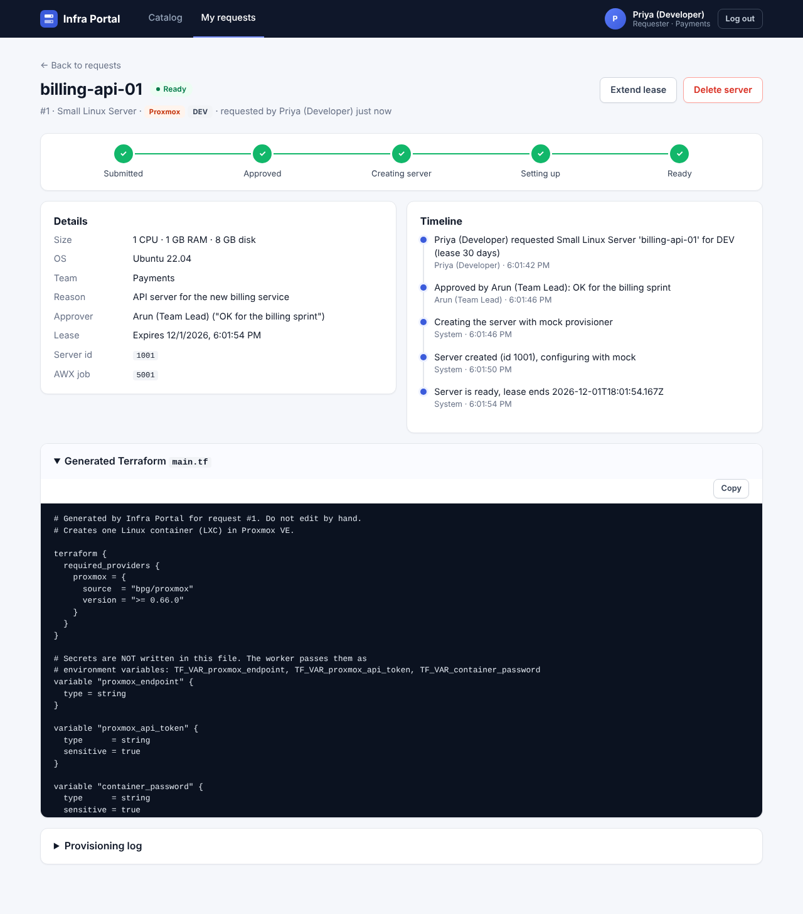

# Infra Portal

A self-service portal for requesting servers on **Proxmox VE** and **AWS**, similar in idea to VMware vRealize Automation (Aria).

A developer picks a server from a catalog. Their team lead approves it. Terraform then creates the server, and the page shows each step live.



## Quick start

You need Docker Desktop. The first build takes 5 to 10 minutes.

```bash
git clone https://github.com/Muthujar/infra-portal.git
cd infra-portal
cp backend/.env.example backend/.env   # Windows: copy backend\.env.example backend\.env
docker compose up --build
```

Open **http://localhost:8080** and click a demo user. The password is `Password@123`.

| Email | Role | Can do |
|---|---|---|
| `dev@demo.local` | Requester | Request servers |
| `lead@demo.local` | Approver | Approve DEV and QA requests for their team |
| `admin@demo.local` | Admin | Approve PROD, edit quotas, read the audit log |

## Modes

The app starts in mock mode, so it runs on any machine. To change mode, edit `backend/.env`, then run `docker compose up -d --force-recreate api worker`.

| Setting | What it does |
|---|---|
| `PROVISIONER=mock` | Simulates Terraform (default) |
| `PROVISIONER=local` | Runs real Terraform. [Proxmox setup](docs/setup-windows-proxmox.md) |
| `PROVISIONER=gitlab` | Runs Terraform in a GitLab pipeline. [GitLab setup](docs/setup-gitlab.md) |
| `CONFIGURATOR=awx` | Runs a real AWX job instead of the simulated one |
| `LDAP_URL` | Turns on company login. [LDAP setup](docs/ldap.md) |

## Tech stack

| Area | Tools |
|---|---|
| Frontend | React, TypeScript, Vite |
| Backend | Node.js, Express, TypeScript, Prisma |
| Data and queue | PostgreSQL, Redis, BullMQ |
| Infrastructure | Terraform, Proxmox VE, AWS, GitLab CI API, AWX API |

## Documents

- [Submission summary](SUBMISSION.md)
- [Architecture](docs/architecture.md)
- [Demo guide](docs/demo.md)
- [Slides (PDF)](docs/Infra-Portal-Presentation.pdf)
- [Development, tests and API](docs/development.md)

## If this moves forward

See [how the next steps would be done](SUBMISSION.md#if-this-moves-forward).
