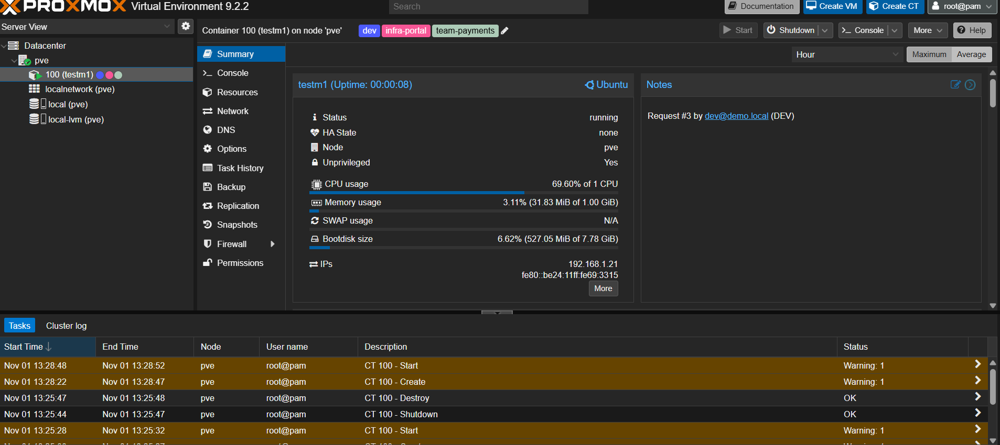

# Submission: Infrastructure Management Tool

A working prototype of a self-service portal for requesting servers on Proxmox VE and AWS, by Muthu.

| Deliverable | Where |
|---|---|
| Source code | This repository: https://github.com/Muthujar/infra-portal |
| Architecture diagram | [docs/architecture.md](docs/architecture.md) |
| Deployment and setup | [README.md](README.md), [Proxmox setup](docs/setup-windows-proxmox.md) |
| Demo and presentation | [docs/demo.md](docs/demo.md), [slides (PDF)](docs/Infra-Portal-Presentation.pdf) |

## Run it

You need Docker Desktop. The app runs in mock mode, so no Proxmox is required.

```bash
git clone https://github.com/Muthujar/infra-portal.git
cd infra-portal
cp backend/.env.example backend/.env   # Windows: copy backend\.env.example backend\.env
docker compose up --build
```

Open http://localhost:8080 and click a demo user.

## What is included

| Part | Status |
|---|---|
| Catalog, request forms, approvals, roles, quotas, leases, audit log | Done |
| API, PostgreSQL, Redis queue, background worker | Done |
| Terraform generation for Proxmox and AWS | Done |
| Provisioning on real Proxmox VE | Done and tested |
| LDAP login (optional) | Done and tested |
| 44 automated tests and CI | Done, passing |
| AWS EC2 | Terraform validated. Not applied, to avoid cloud cost |
| GitLab CI | Connector built. Commits to gitlab.com work and a runner is online. The pipeline did not run, because gitlab.com requires account verification |
| AWX | Connector built, not tested. Mocked in the demo, because AWX needs Kubernetes |
| SAML | Not built. Next step, using the same group-to-role mapping as LDAP |

## Tested on real Proxmox

Running against Proxmox VE 9.2, the portal created container 100 with Terraform in about 40 seconds, then deleted it on decommission.


