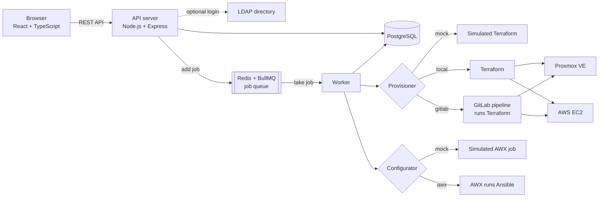
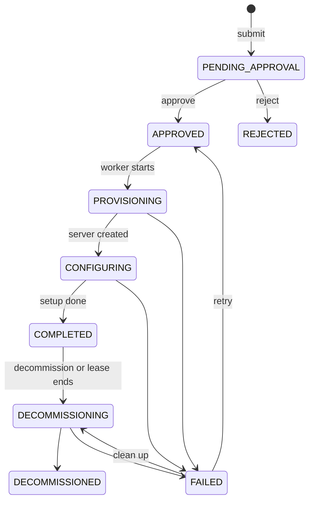

# Architecture

## System overview

| Part | Job |
|---|---|
| React UI | Catalog, requests, approvals and admin screens |
| API server | Login, permissions, quotas, approval rules, Terraform generation |
| PostgreSQL | Stores requests and their full history |
| Redis queue | Passes slow work from the API to the worker |
| Worker | Creates, configures and deletes servers. Deletes servers when their lease ends |
| Provisioner, Configurator | Swappable mock or real connectors |

**Key idea:** provisioning takes minutes, so the API only saves the decision and queues a job. Mock and real connectors share one interface, so moving to real systems is a settings change.

## Request life cycle

One function makes every status change. It blocks moves that are not allowed, stops two people acting at once, and writes the audit log.

## Security

- Every API call except login needs a valid token.
- Requesters see only their own requests. Approvers see their team's.
- Nobody can approve their own request, and PROD needs an admin.
- Team quotas are checked on request, approval and retry.
- Passwords are stored as hashes. With LDAP, the portal never stores them.
- Proxmox and AWS secrets are never saved in `main.tf` or the database.
- All input is validated on the server.

## When things fail

- **Terraform or a connector fails:** the request shows Failed with its log, and offers Retry or Decommission.
- **Redis is down:** the request is marked Failed, and Retry queues it again later.
- **The worker crashes:** the request is marked Failed. Retry continues from Terraform's saved state, so no duplicate is created.

## More diagrams

[Request sequence](diagrams/request-sequence.png) · [Data model](diagrams/data-model.png)
