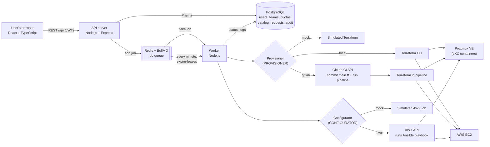
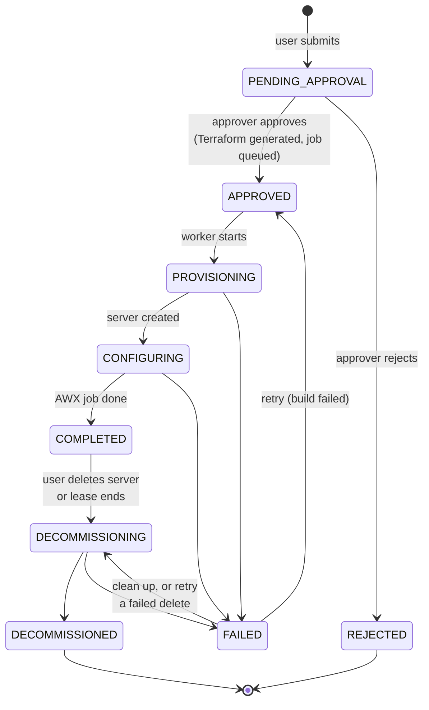
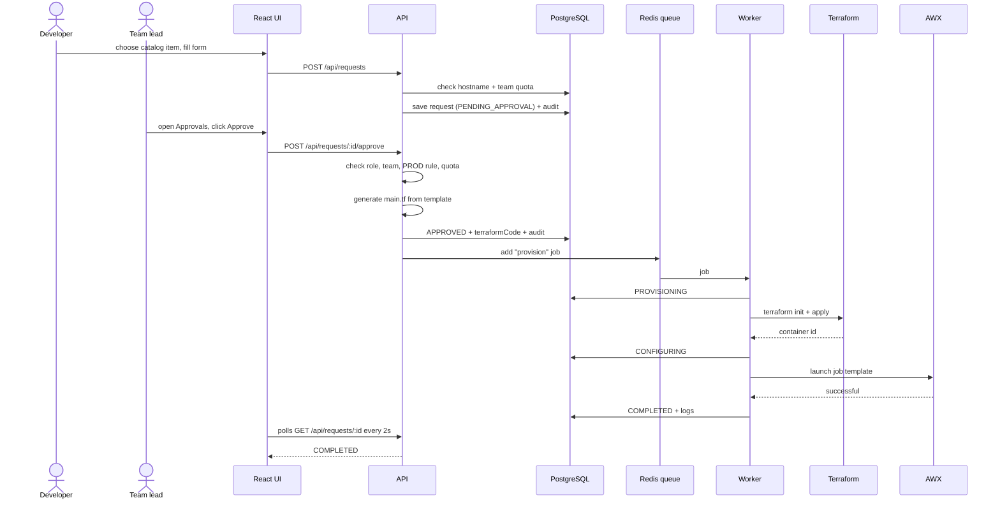
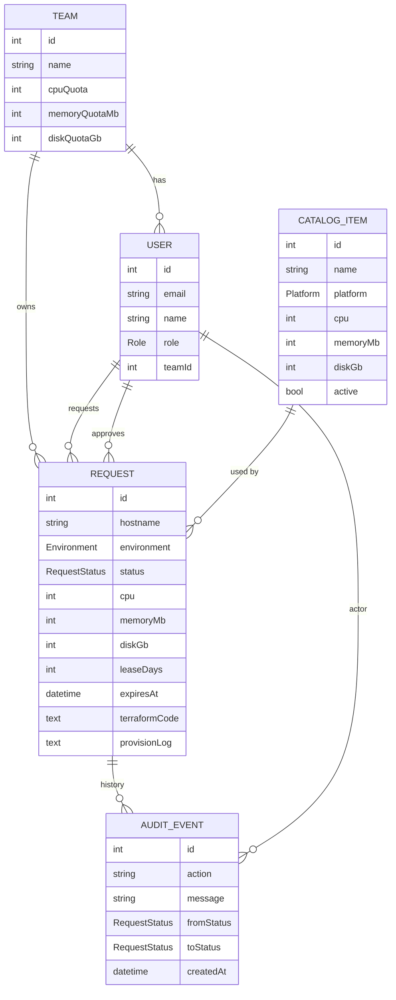

# Architecture

The diagrams below are written in Mermaid, so GitHub draws them on this page. The same diagrams are also saved as image files in [`docs/diagrams/`](diagrams/):
[system overview](diagrams/system-overview.png), [request life cycle](diagrams/request-lifecycle.png), [request sequence](diagrams/request-sequence.png) and [data model](diagrams/data-model.png).

## System overview

### Components

| Component | Responsibility |
|---|---|
| **React front end** | Catalog, request form, live request status, approvals screen, admin screen. Hides pages the user's role cannot use. |
| **API server** | Login (JWT), RBAC checks, input validation (Zod), quota checks, approval rules, Terraform generation, audit log. Never does slow work itself. |
| **PostgreSQL** | Single source of truth for requests and their history. |
| **Redis + BullMQ** | Queue between the API and the worker. The API answers in milliseconds; provisioning can take minutes. |
| **Worker** | Takes jobs from the queue, runs the provisioner and configurator, and moves the request through its statuses. Runs at most 2 jobs at once. Every minute it also decommissions servers whose lease has ended. |
| **Provisioner** | Creates or deletes the server. Same interface for all three implementations: mock, local Terraform, GitLab pipeline. |
| **Configurator** | Sets up software inside the new server. Same interface for mock and AWX. |

The **connector pattern** (one interface, a mock and a real implementation) means the demo can run on any laptop, and switching to real systems is only a configuration change.

## Request life cycle (state machine)

All status changes go through one function (`changeStatus` in `backend/src/services/requestStatus.service.ts`). It:

1. checks that the move is allowed (for example, a REJECTED request can never be provisioned),
2. updates the row **only if the status has not changed in the meantime**, which prevents two approvers or two workers from acting on the same request,
3. writes an audit event with who did it, when, and the old and new status.

## Sequence: request to ready server

## Security and RBAC rules

| Rule | Where it is enforced |
|---|---|
| Every API call except login needs a valid JWT | `requireAuth` middleware |
| Admin-only endpoints (quotas, catalog changes, audit log) | `requireRole(["ADMIN"])` |
| Requesters see only their own requests; approvers see their team's | `visibleRequestsFilter` in `requests.routes.ts` |
| Nobody can approve their own request | `checkCanApprove` |
| Approvers can approve only their team's DEV/QA requests | `checkCanApprove` |
| PROD requests need an admin | `checkCanApprove` |
| Team quota is checked on request, on approval and on retry | `assertQuotaAvailable` |
| Passwords are stored as bcrypt hashes | `seed.ts`, `auth.routes.ts` |
| Proxmox / AWS secrets never go into `main.tf` or the database; they are passed to Terraform as `TF_VAR_*` environment variables | `terraform/runner.ts` |
| All input is validated (hostname format, sizes, comments) | Zod schemas in each route |

## Data model

The request copies the size from the catalog item, so changing the catalog later does not change existing servers or quota usage.
