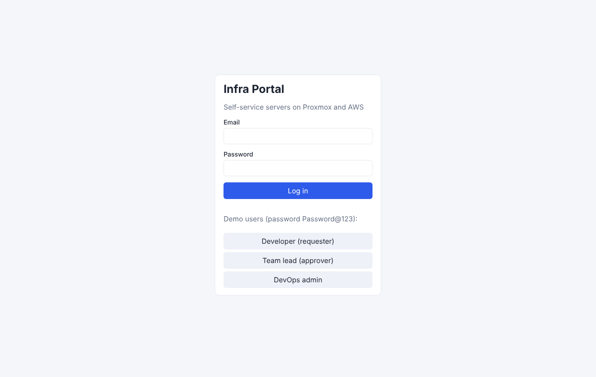
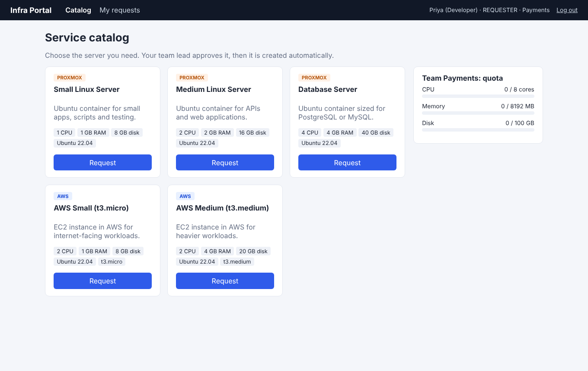
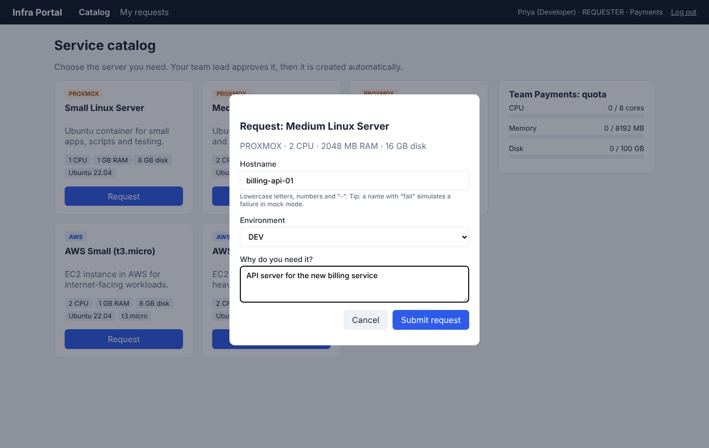
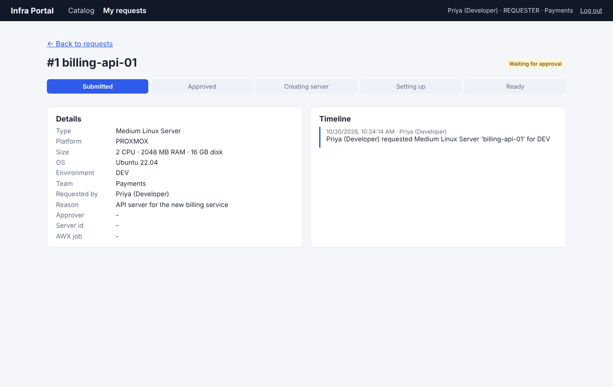
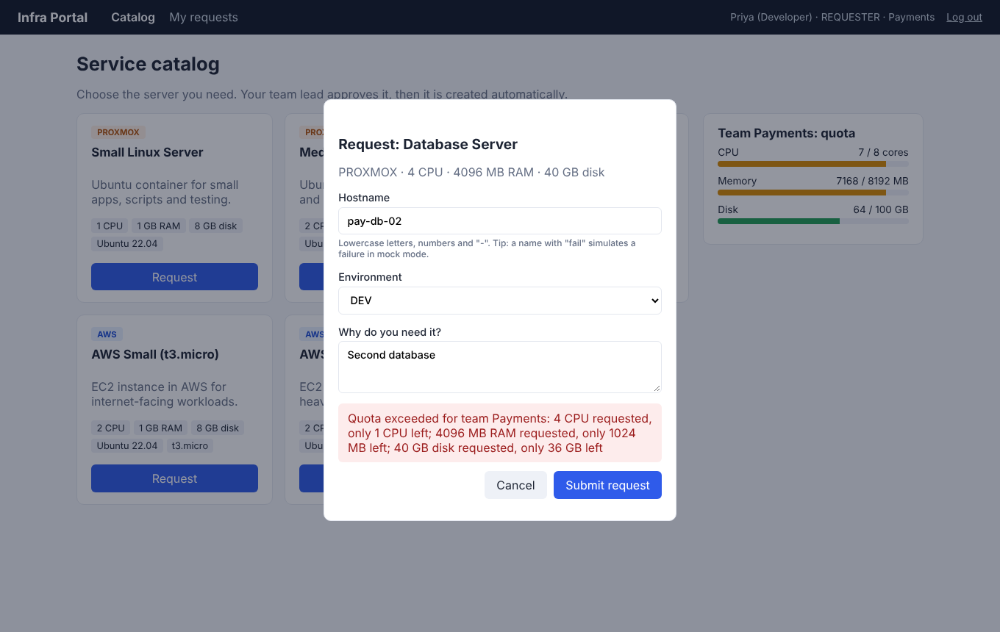
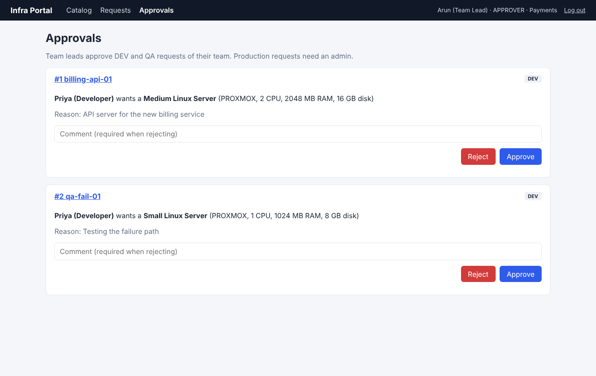
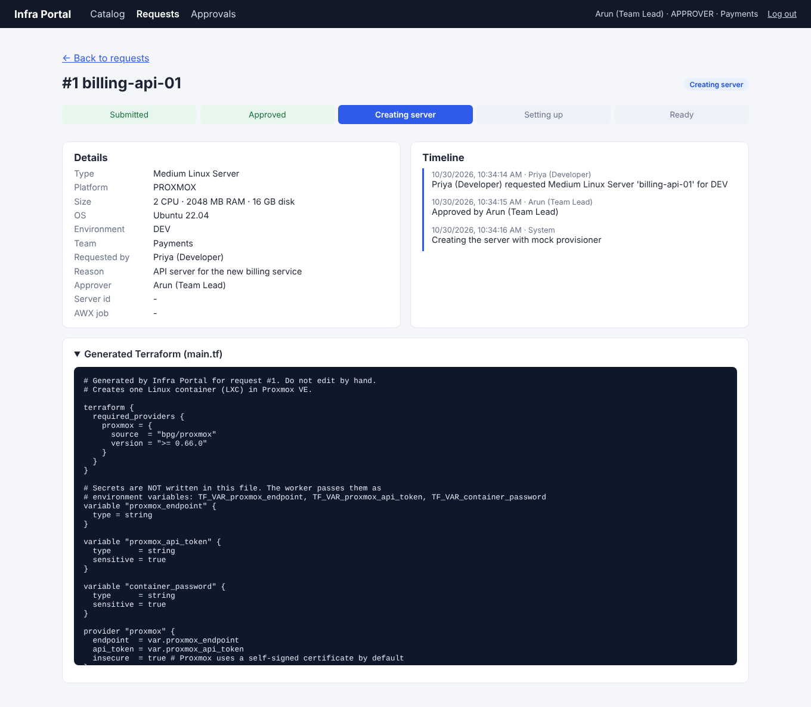
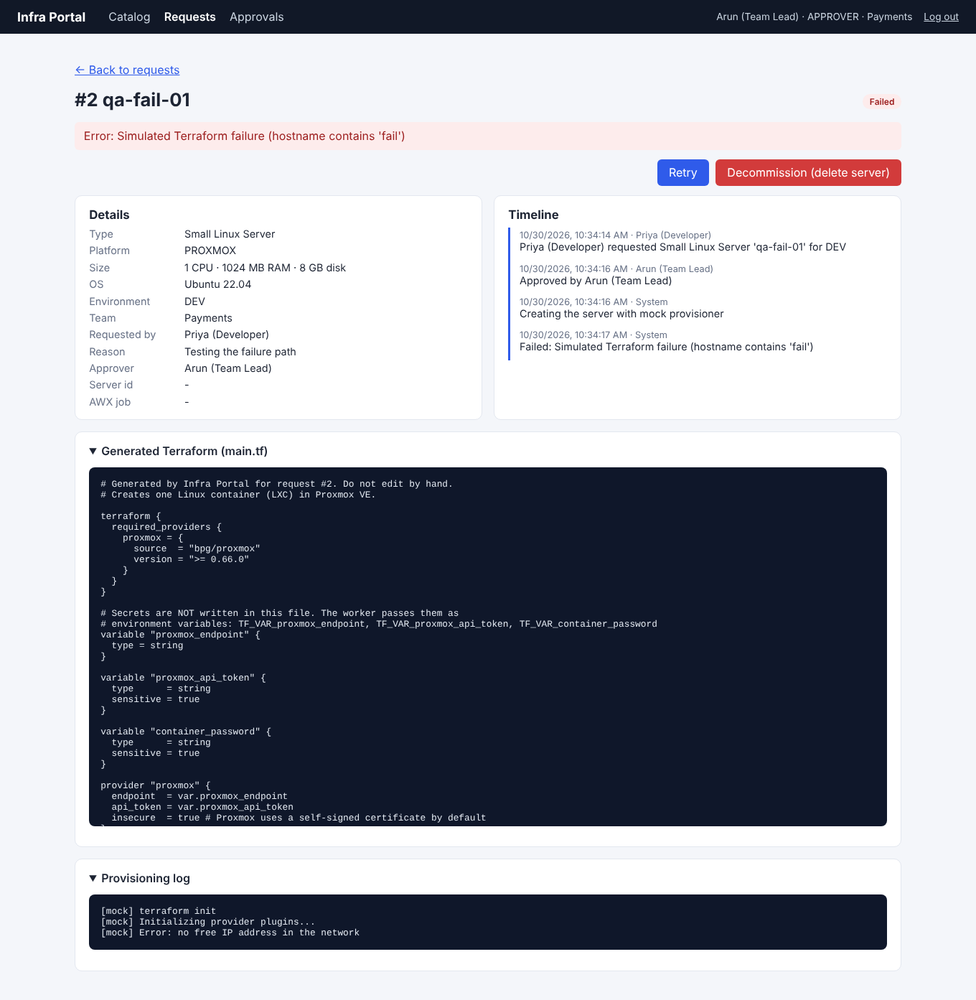
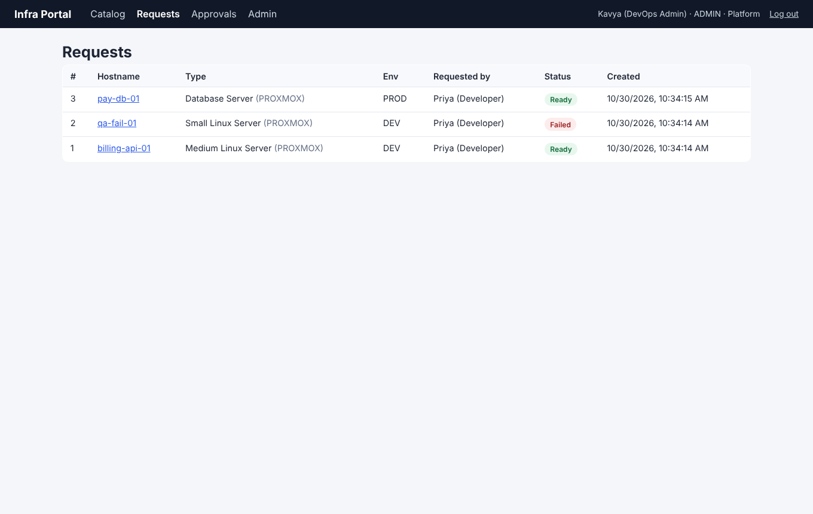
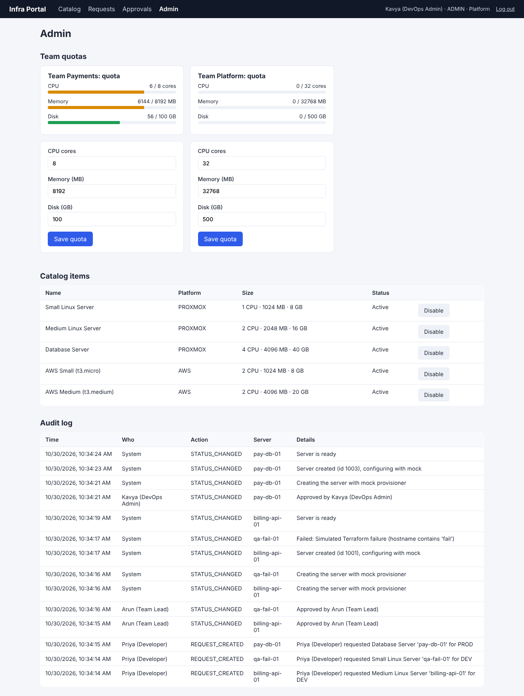

# Demo guide

This guide walks through the prototype as a short story. Each step lists what to click and what it shows. All screenshots are in `docs/screenshots/`.

## The problem

Today a developer who needs a server raises a ticket, waits for the DevOps team, and the server is created by hand. That is slow, every server ends up slightly different, and there is no clear record of who asked for what and who approved it.

**Infra Portal** turns this into a self-service flow: pick from a catalog, get approval, and automation creates and configures the server.

## 1. Log in

Three demo users show the three roles (RBAC): developer, team lead and DevOps admin. Click **Developer (requester)**.

## 2. Browse the service catalog

- Standard server sizes on **Proxmox** (company's own hardware) and **AWS** (public cloud).
- The quota box on the right shows how much CPU, RAM and disk the team is already using.

## 3. Request a server

Click **Request** on *Medium Linux Server*, enter hostname `billing-api-01`, choose **DEV**, and give a reason.
The API validates the hostname, checks that it is not already in use, and checks the team quota.

## 4. Quota enforcement

Request two *Database Servers*. The second one is blocked before it reaches anyone, with a clear message that says exactly which limit is exceeded.

## 5. Approve as team lead

Log out and click **Team lead (approver)**, then open **Approvals**.

- The lead sees only their team's DEV/QA requests.
- The PROD database request is **not** shown, because production needs an admin.
- Click **Approve**. At this moment the API generates the Terraform code and puts a job on the queue.

## 6. Watch it being created

Open the request. The progress bar and timeline update every 2 seconds:
**Approved → Creating server (Terraform) → Setting up (AWX) → Ready**

- **Generated Terraform (main.tf):** the exact code used to create the server. It contains no secrets.
- **Timeline:** the audit trail, showing who did what and when.
- **Provisioning log:** the Terraform and AWX output.

With `PROVISIONER=local` and Proxmox running, the container now also appears in the Proxmox web UI.

## 7. Failure and retry

A request whose hostname contains `fail` simulates a Terraform error in mock mode. The request shows **Failed**, the error message and the log, with **Retry** and **Decommission** buttons. Failed requests release their quota.

## 8. Admin view

Log in as **DevOps admin**:

- **Approvals:** approve the PROD request.
- **Requests:** see every team's requests.
- **Admin:** change team quotas, disable a catalog item, and read the full audit log.

## 9. Decommission

On a ready server, click **Decommission**. The worker runs `terraform destroy`, the status becomes **Deleted** and the quota is released.

## What is real and what is simulated

| Part | Status |
|---|---|
| UI, API, database, RBAC, quotas, approvals, audit log, queue and worker | Real |
| Terraform code generation | Real |
| Running Terraform against Proxmox (`PROVISIONER=local`) | Real, needs Proxmox (for example in VirtualBox) |
| AWS | Terraform generated and validated; apply disabled by default to avoid cost |
| GitLab pipeline (`PROVISIONER=gitlab`) | Real API code and sample `.gitlab-ci.yml`; mock used in the demo |
| AWX (`CONFIGURATOR=awx`) | Real API code and sample playbook; mock used in the demo |
| SAML / LDAP login | Not built; local JWT login with roles. Next step: Keycloak or Active Directory groups mapped to roles |

## Key design decisions

1. **Queue + worker.** Provisioning takes minutes, so the API only records the decision and queues a job. The UI polls for status. If the worker restarts, jobs are still in Redis.
2. **One state machine.** Every status change goes through one function that checks allowed transitions, guards against two people acting at once, and writes the audit log.
3. **Connector interfaces.** Mock and real implementations share the same interface, so the demo runs anywhere and production only needs configuration.
4. **Generated, reviewable Terraform.** The approver's decision and the exact code are saved together, so you can always see what was built.
5. **Secrets stay out of code.** Credentials are passed to Terraform as environment variables, never written to `main.tf` or the database.
