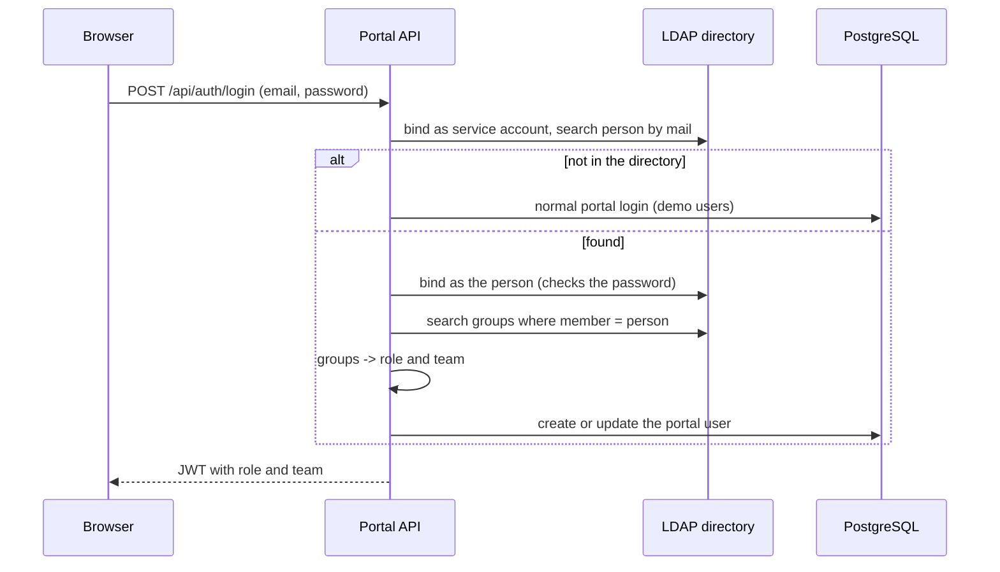

# Company login with LDAP

Companies keep their staff in a directory (LDAP, for example Active Directory or OpenLDAP). With LDAP switched on,
people log in to the portal with their company email and password, and their **directory groups decide their portal
role and team**. When someone leaves the company or changes team, the directory changes and the portal follows at the
next login. Nobody maintains users in the portal.

LDAP is off by default, so the portal still runs anywhere with the demo users.

## How a login works



| Directory group | Portal result |
|---|---|
| `portal-admins` | role Admin |
| `portal-approvers` | role Approver |
| `portal-requesters` | role Requester |
| `team-<name>`, e.g. `team-payments` | team `<name>` (must exist in the portal) |
| none of the role groups | login refused (403) |

If the directory cannot be reached, the portal falls back to its own users, so the admin can still log in.

## Try it with the demo directory

The repo includes a small OpenLDAP directory ([`ldap/bootstrap.ldif`](../ldap/bootstrap.ldif)).

1. In `backend/.env`, uncomment the `LDAP_*` lines:
   ```
   LDAP_URL=ldap://ldap:389
   LDAP_BIND_DN=cn=admin,dc=corp,dc=local
   LDAP_BIND_PASSWORD=admin
   LDAP_USER_BASE=ou=people,dc=corp,dc=local
   LDAP_GROUP_BASE=ou=groups,dc=corp,dc=local
   ```
2. Start everything with the `ldap` profile:
   ```bash
   docker compose --profile ldap up -d --build
   docker compose up -d --force-recreate api
   ```
3. Open http://localhost:8080. The login page says "Company login is on". Log in with (password `Password@123`):

| Email | Directory groups | Portal role and team |
|---|---|---|
| `meera@corp.local` | portal-requesters, team-payments | Requester, Payments |
| `ravi@corp.local` | portal-approvers, team-payments | Approver, Payments |
| `sana@corp.local` | portal-admins, team-platform | Admin, Platform |
| `guest@corp.local` | none | refused |

The demo users (`dev@demo.local` and so on) still work, because they are not in the directory.

## Using a real company directory

Set the same five values to the company's server and a read-only service account, for example
`LDAP_URL=ldaps://ad.corp.example.com:636`, and set `LDAP_ADMIN_GROUP`, `LDAP_APPROVER_GROUP`,
`LDAP_REQUESTER_GROUP` and `LDAP_TEAM_GROUP_PREFIX` to the company's group names. The code is in
[`backend/src/services/ldap.service.ts`](../backend/src/services/ldap.service.ts).

Notes for production:
- Use `ldaps://` (TLS), so passwords are encrypted on the network.
- Active Directory usually finds people by `mail` or `userPrincipalName`, and its groups are `group` objects. The
  search filters in `ldap.service.ts` are the place to adjust.
- **SAML** (single sign-on through the company login page, for example with Keycloak, Okta or Entra ID) is the next
  step. It would replace the password form with a redirect, and the same group-to-role mapping would apply.

## Tests

`backend/tests/ldap.test.ts` logs in against the demo directory (CI starts it for every push): role and team from
groups, wrong password, user without groups, demo users still working, and fallback when the directory is down.
