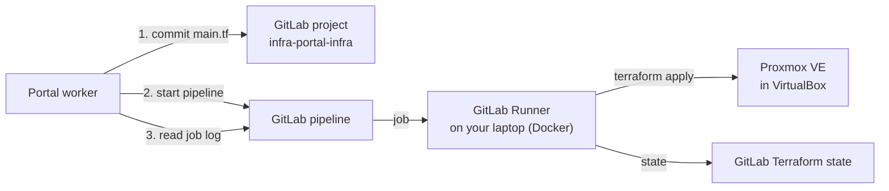

# Run provisioning through GitLab CI (PROVISIONER=gitlab)

With this mode the portal does not run Terraform itself. When a request is approved, the worker:

1. commits the generated `main.tf` to `requests/request-<id>/main.tf` in a GitLab project,
2. starts a pipeline with `REQUEST_ID` and `TF_ACTION=apply` (or `destroy` when the server is decommissioned),
3. waits for the pipeline, then copies the job's Terraform output into the request's provisioning log.

The pipeline runs on a GitLab Runner on your own laptop, because gitlab.com's shared runners cannot reach a Proxmox
server on your home network. Terraform state is kept in GitLab (*Operate > Terraform states*), one state per request.



**Before you start:** finish [setup-windows-proxmox.md](setup-windows-proxmox.md) up to and including the token test
in Part 3. Time needed: about 30 minutes. Everything below is free on gitlab.com.

## 1. Create the GitLab project

1. Sign in to https://gitlab.com (create a free account if needed).
2. **New project > Create blank project**. Name: `infra-portal-infra`. Visibility: Private.
   Keep **Initialize repository with a README** ticked, so the `main` branch exists.
3. In the project, click **+ > New file**, name it `.gitlab-ci.yml`, paste the contents of
   [`gitlab/.gitlab-ci.yml`](../gitlab/.gitlab-ci.yml) from this repo, and commit to `main`.

## 2. Add the Proxmox secrets as CI/CD variables

*Settings > CI/CD > Variables > Add variable*, three times. Untick **Protect variable**. Use **Masked** where GitLab
accepts the value; otherwise **Visible** is fine for a lab.

| Key | Value |
|---|---|
| `TF_VAR_proxmox_endpoint` | `https://192.168.1.200:8006/` (your Proxmox address) |
| `TF_VAR_proxmox_api_token` | `root@pam!portal=<secret>` |
| `TF_VAR_container_password` | the root password for new containers, e.g. `ChangeMe@123` |

## 3. Start a runner on your laptop

1. *Settings > CI/CD > Runners > New project runner*. Tags: `infra-portal`. Click **Create runner** and copy the
   token that starts with `glrt-`.
2. From the root of this repo, register it once and start it:
   ```powershell
   docker compose -f gitlab/runner/docker-compose.yml run --rm runner register --non-interactive --url https://gitlab.com --token glrt-XXXX --executor docker --docker-image alpine:3.20
   docker compose -f gitlab/runner/docker-compose.yml up -d
   ```
3. Refresh the Runners page in GitLab. The runner should show a green dot (online).

## 4. Create a token for the portal

*Your avatar > Edit profile > Access tokens > Add new token*. Name: `infra-portal`. Scope: **api**.
Copy the token (it starts with `glpat-`). Do not commit it anywhere.

## 5. Point the portal at GitLab

In `backend\.env`:

```
PROVISIONER=gitlab
GITLAB_URL=https://gitlab.com
GITLAB_TOKEN=glpat-XXXX
GITLAB_PROJECT_ID=your-gitlab-name/infra-portal-infra
GITLAB_BRANCH=main
```

Keep the `PROXMOX_*` values from the Proxmox guide: the portal still uses them to fill in the Terraform template
(node, storage, template, bridge), and the check below uses them to test Proxmox.

Restart the API and worker, then run the setup check:

```powershell
docker compose up -d --force-recreate api worker
docker compose run --rm api npx tsx scripts/check-setup.ts
```

The check reads (never changes) Proxmox and GitLab and prints `OK` or what to fix for each item: token, node, storage,
template, project, `.gitlab-ci.yml`, CI/CD variables and an online runner with the `infra-portal` tag.

## 6. Run a real request

1. Log in as `dev@demo.local`, request a **Small Linux Server** (Proxmox) in DEV.
2. Log in as `lead@demo.local` and approve it.
3. On the request page, the status moves to **Creating server**. The provisioning log shows the commit link and the
   pipeline link.
4. In GitLab you see the new commit under `requests/request-<id>/` and a running pipeline (*Build > Pipelines*).
5. When the pipeline passes, the request shows the Proxmox container id, and the container appears in Proxmox.
6. Click **Decommission**. A second pipeline runs `terraform destroy` and the container disappears.

## Troubleshooting

| Symptom | Likely cause and fix |
|---|---|
| "Could not commit main.tf to GitLab (HTTP 401)" | The token is wrong or expired, or it lacks the `api` scope. |
| "Could not commit main.tf to GitLab (HTTP 404)" | `GITLAB_PROJECT_ID` is wrong. Use the path shown in the project URL, e.g. `your-name/infra-portal-infra`. |
| "Could not start GitLab pipeline (HTTP 400)" with "No stages / jobs" | `.gitlab-ci.yml` is missing on `main`, or it is not the version from this repo. |
| Pipeline stays **pending** | No online runner has the `infra-portal` tag. Check the runner in *Settings > CI/CD > Runners* and `docker compose -f gitlab/runner/docker-compose.yml logs`. |
| Job fails at `terraform init` | The runner needs internet access to registry.terraform.io and gitlab.com. |
| Job fails with a Proxmox connection error | The job container cannot reach Proxmox: check `TF_VAR_proxmox_endpoint` and that the laptop can open `https://<ip>:8006`. |
| Job fails with "storage" or "template" in the error | Run the setup check from step 5; it lists the names Proxmox actually has. |
